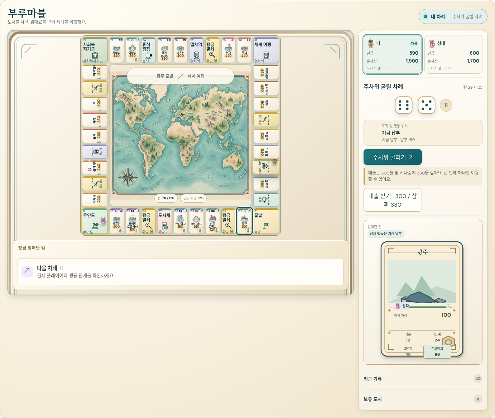
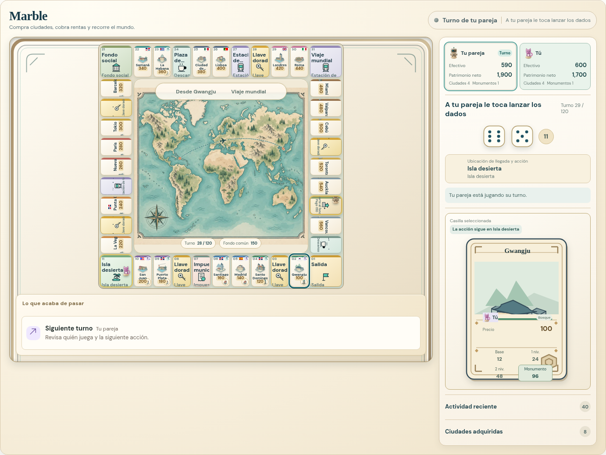
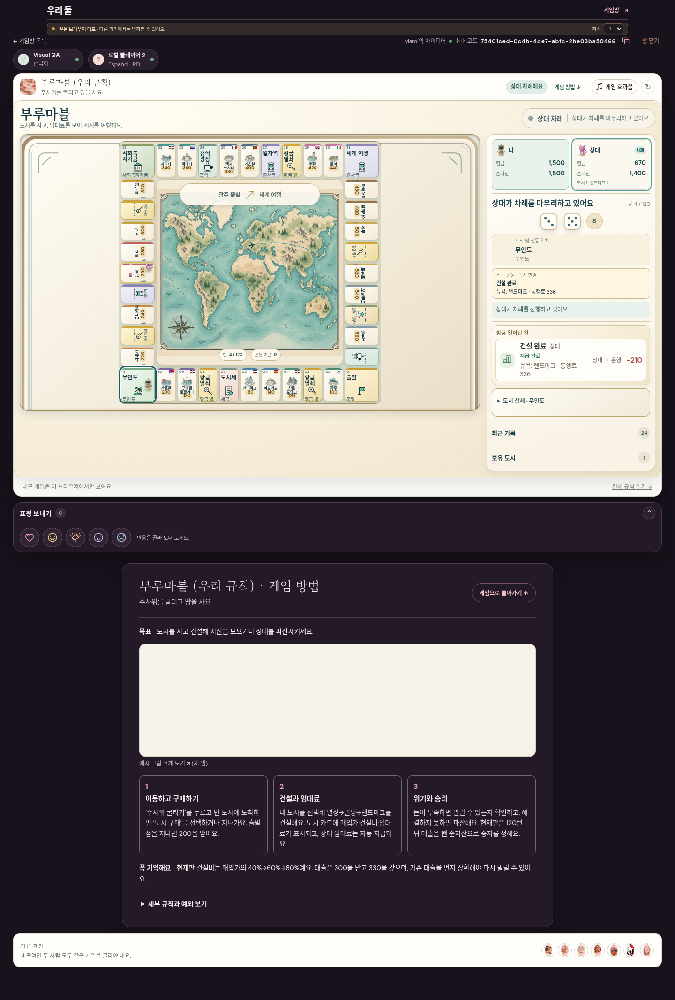
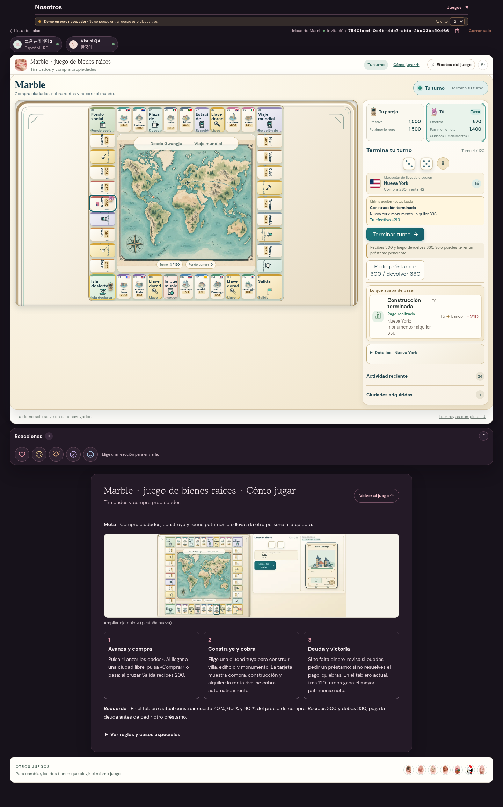

# 부루마블

28턴, 도시4개씩·랜드마크2·별장6, 현금590:600. 이후 UX·황금열쇠 수정 전 화면.

[한국어 원본](ko.png) · [스페인어 원본](es.png)

## 수정 후 기능 확인

수정 후 실제 데모 방에서 도시를 구매하고 건설 UI를 확인한 화면이다. 28턴 독립 감사 사진과는 다른 대국이며 중반 완주를 의미하지 않는다.

